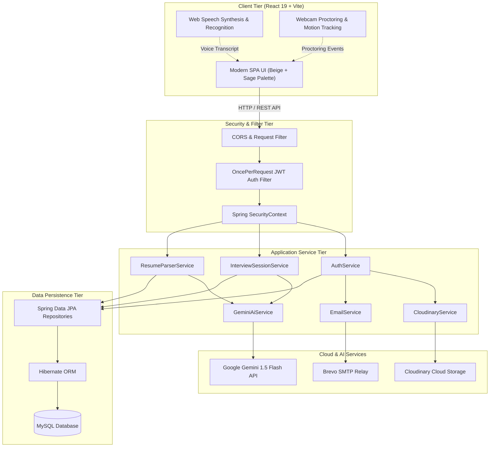
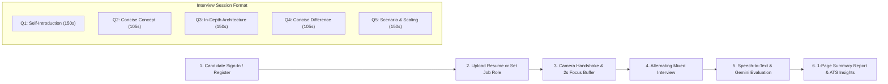

# 🎙️ AI Interview Coach

> An intelligent, full-stack technical and behavioral mock interview platform powered by **Spring Boot 3**, **React 19**, and **Google Gemini 1.5 Flash**. Includes real-time speech recognition, webcam anti-cheat proctoring, resume ATS auditing, and tailored job-specific interview generation.

---

## 🛠️ Technology Stack

| Layer | Technologies & Frameworks |
| :--- | :--- |
| **Backend** | Java 17, Spring Boot 3.4.3, Spring Security, Spring Data JPA, Hibernate |
| **Database** | MySQL 8.x / MariaDB |
| **AI / LLM Engine** | Google Gemini API (`gemini-1.5-flash`) |
| **Security & Auth** | Stateless JWT (HMAC-SHA256), BCrypt Password Hashing |
| **Cloud & Media** | Cloudinary Cloud Storage (Candidate avatars), Brevo SMTP (Email activation & reset) |
| **Document Parsing** | Apache PDFBox (`.pdf`), Apache POI (`.docx`) |
| **Frontend** | React 19, Vite, WebRTC MediaStream, Web Speech Recognition & Synthesis APIs |
| **Design System** | Responsive Beige + Sage Green aesthetic palette, SVG iconography |

---

## 🏛️ System Architecture



---

## 🔄 End-to-End Workflow



### Workflow Steps:
1. **Candidate Onboarding**: Register with a profile avatar (uploaded to Cloudinary) and email activation.
2. **Context Setup**: Candidate either uploads their resume (PDF/Word) or provides a target **Job Role & Job Description**.
3. **Camera Proctoring & 2s Buffer**: Camera feed activates for tab-switching and movement tracking; clicking **Start Interview** pauses for 2 seconds to let the candidate compose themselves before Question 1 begins.
4. **Balanced 50/50 Mixed Interview**:
   - **Question 1**: Mandatory Icebreaker (*"Introduce yourself..."*, 150s timer).
   - **Concise Questions**: Short definitions, annotations, and key differences (105s timer, 90–120s range).
   - **In-Depth Questions**: Real-world architecture, trade-offs, concurrency, and failure resilience (150s timer).
5. **Real-time Voice & AI Evaluation**: Candidate speaks their answer; speech recognition transcribes text in real-time, evaluated by Gemini against must-mention technical keywords and benchmark answers.
6. **Analytics & One-Page Summary**: Visual performance charts, candidate score out of 10, strengths, concrete improvement areas, and downloadable summary report.

---

## 🔒 Protecting Keys & Environment Setup

All sensitive credentials (passwords, JWT secret, Cloudinary keys, Gemini API key, SMTP tokens) are externalized into environment variables and excluded from Git via `.gitignore`.

### 1. Create your `.env` file
Copy the provided `.env.example` template:
```bash
cp .env.example .env
```

### 2. Configure credentials in `.env`
```properties
# Server
SERVER_PORT=8080

# Database
DB_HOST=localhost
DB_PORT=3306
DB_NAME=ai_coach_interview
DB_USERNAME=root
DB_PASSWORD=your_mysql_password

# Cloudinary
CLOUDINARY_CLOUD_NAME=your_cloud_name
CLOUDINARY_API_KEY=your_api_key
CLOUDINARY_API_SECRET=your_api_secret

# JWT Authentication
JWT_SECRET=your_256_bit_jwt_secret_hex_or_base64
JWT_EXPIRATION_MS=86400000
FRONTEND_URL=http://localhost:8080

# Mail (Brevo / SMTP)
MAIL_HOST=smtp-relay.brevo.com
MAIL_PORT=587
MAIL_USERNAME=your_smtp_username
MAIL_PASSWORD=your_smtp_password
MAIL_FROM=your_email@example.com

# Google Gemini AI
GEMINI_API_KEY=your_gemini_api_key_here
GEMINI_MODEL=gemini-1.5-flash
```

> **Note**: `AiCoachInterviewApplication` automatically loads the `.env` file on startup into system properties if present.

---

## 🚀 Getting Started

### Prerequisites
- **Java 17+** (JDK)
- **Maven 3.8+**
- **Node.js 18+** & npm
- **MySQL 8.0+**

### 1. Build Frontend
```bash
# Install frontend dependencies
npm --prefix frontend install

# Build production bundle
npm --prefix frontend run build
```

### 2. Run Spring Boot Backend
```bash
# Run application
mvn spring-boot:run
```

The application will start on:  
👉 **http://localhost:8080**

---

## 🛡️ License & Authors
Developed by **Bhushan Rajurkar** — Built with clean architecture, enterprise security, and AI-assisted coaching.

